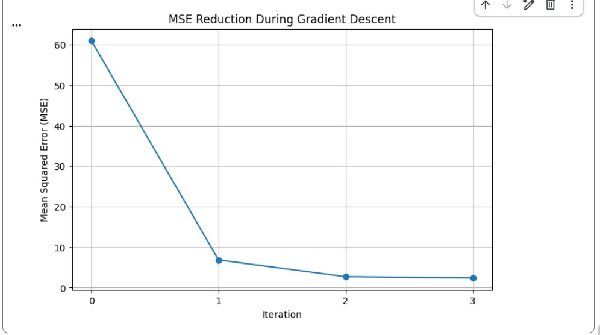
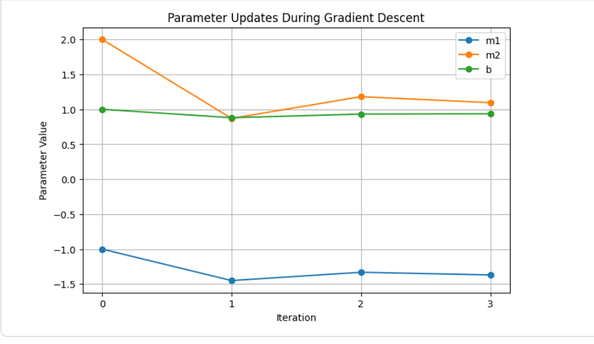

## Formative 3 - Probability Distributions, Bayesian Probability, and Gradient Descent Implementation
## Part 3 : Gradient Descent 

## [View the Jupyter Notebook](https://colab.research.google.com/drive/1I9rasJMWwKXod7UBxlvfI1thS5Rpq972?usp=sharing)

## Overview
Implemented linear regression with two input features and applied gradient
descent to optimize the model's weights and bias.

## Implementation
- Calculated predictions and Mean Squared Error (MSE)
- Computed gradients using the chain rule
- Updated the model parameters over three iterations
- Used SciPy to approximate derivates and Matplotlib to visualize the results

## Results 
The MSE decreased from 61.00 initially to 2.39 after three updates,
indicating an improvement in the model's predictions

## Visualizations
| Visualization 1 | Visualization 2 |
| :---: | :---: |
|  |  |
