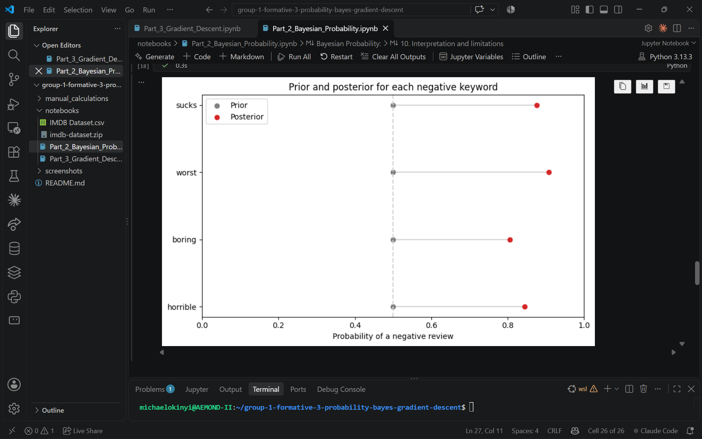
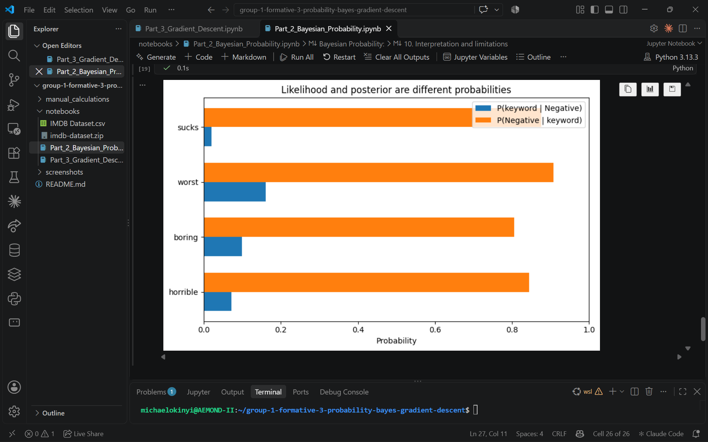
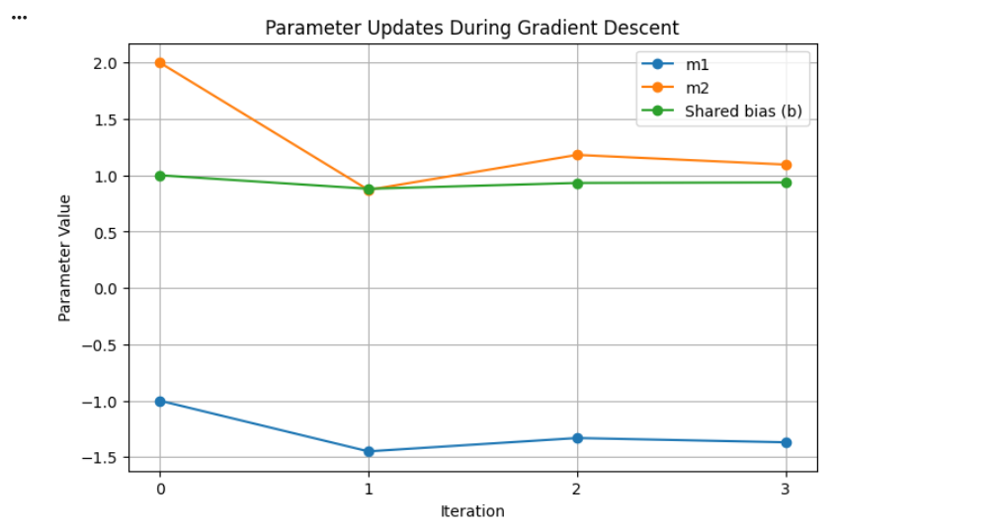

## Formative 3 - Probability Distributions, Bayesian Probability, and Gradient Descent Implementation
## Part 1: Probability Distributions 

  

## Part 2: Bayesian Probability

## [View the Bayesian Probability Code in Jupyter Notebook](https://colab.research.google.com/drive/1gjpdRFj4dctJNPjS5bIJ8nawfWVyo_-F)

## Overview
Used Bayes’ Theorem to estimate the probability that an IMDB review is negative, given that it contains one of four selected negative keywords: **horrible**, **boring**, **worst**, or **sucks**. The analysis uses 50,000 labeled reviews and calculates the prior, likelihood, marginal probability, and posterior for each keyword.

## Implementation
- Loaded the IMDB review dataset and prepared each review for exact keyword matching.
- Stored each review’s words as a set, so a keyword is counted at most once per review.
- Calculated the prior as the proportion of all reviews labeled negative: `P(Negative) = 25,000 / 50,000 = 0.5`.
- For each keyword, calculated the likelihood `P(keyword | Negative)` and marginal `P(keyword)`.
- Applied Bayes’ Theorem: `P(Negative | keyword) = P(keyword | Negative) × P(Negative) / P(keyword)`.
- Compared each posterior with a direct count, `negative reviews containing keyword / all reviews containing keyword`, to check the result.
- Visualized the prior-to-posterior change and compared likelihood with posterior. The calculations use basic Python; Matplotlib is used for the charts.

## Results
| Keyword | Prior | Likelihood P(keyword \| Negative) | Marginal P(keyword) | Posterior P(Negative \| keyword) |
| :--- | ---: | ---: | ---: | ---: |
| horrible | 0.5000 | 0.0708 | 0.0419 | 0.8449 |
| boring | 0.5000 | 0.0983 | 0.0610 | 0.8064 |
| worst | 0.5000 | 0.1608 | 0.0886 | 0.9076 |
| sucks | 0.5000 | 0.0190 | 0.0108 | 0.8764 |

The direct-count check matched the Bayes posterior for each keyword. For example, `P(worst | Negative)` is 0.1608, while `P(Negative | worst)` is 0.9076. These are different conditional probabilities: the first asks how often “worst” appears in negative reviews; the second asks how often a review is negative when it contains “worst.” The prior and marginal connect these quantities in Bayes’ Theorem.

## Visualizations
The prior-to-posterior chart shows how each keyword shifts the baseline probability of a negative review (0.5).

The likelihood-versus-posterior chart highlights that `P(keyword | Negative)` and `P(Negative | keyword)` answer different questions and can have substantially different values.

| Visualization 1 | Visualization 2 |
| :---: | :---: |
|  |  |

## Keyword Rationale
We selected **horrible**, **boring**, **worst**, and **sucks** because they express negative judgment in different ways: a strong evaluation, a reaction to the experience, a comparison, and an informal criticism. 

This gives us a range of negative signals rather than four near-synonyms. Because matching is exact, related forms such as “sucked” are not counted.

## Limitations
These results describe associations in this dataset, not proof that a keyword causes negative sentiment.

Negation, sarcasm, and context can affect how a word is used, and exact matching does not include related word forms.

## Part 3 : Gradient Descent 

## [View the Gradient Descent Code in Jupyter Notebook](https://colab.research.google.com/drive/1I9rasJMWwKXod7UBxlvfI1thS5Rpq972?usp=sharing)

## Overview
Implemented linear regression with two input features and applied gradient
descent to optimize the model's weights and bias.

## Implementation
- Calculated predictions and Mean Squared Error (MSE)
- Computed gradients using the chain rule
- Updated the model parameters over three iterations
- Used SciPy to approximate derivates and Matplotlib to visualize the results

## Results 
We implemented gradient descent to optimize the weights (\(m_1, m_2\)) and a single shared bias (\(b\)) of a linear regression model over three iterations. The MSE decreased at every update, from 61.00 to 6.85, 2.72, and finally 2.39, showing that the model's predictions improved. The final weights were approximately \(m = [-1.37, 1.10]\) and \(b = 0.94\), producing predictions of \([2.85, 6.41]\) against actual values of \([5, 6]\). The manually calculated gradients matched SciPy's numerical derivatives at each iteration.

## Visualizations
| Visualization 1 | Visualization 2 |
| :---: | :---: |
|  |  |
