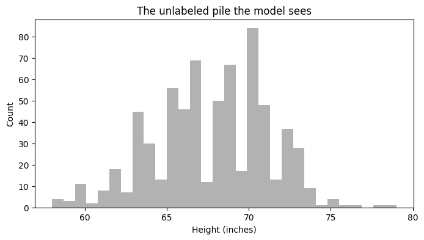
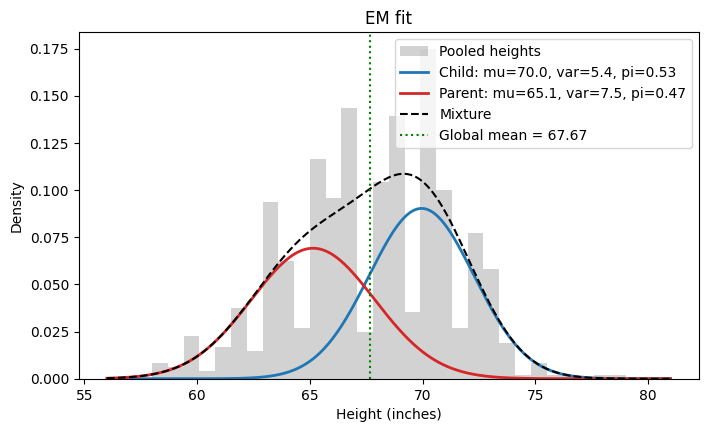
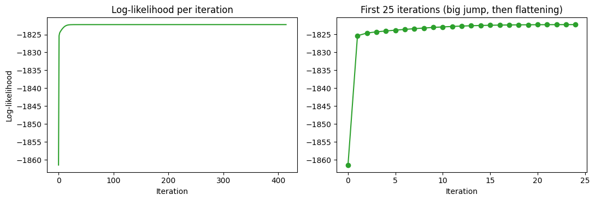
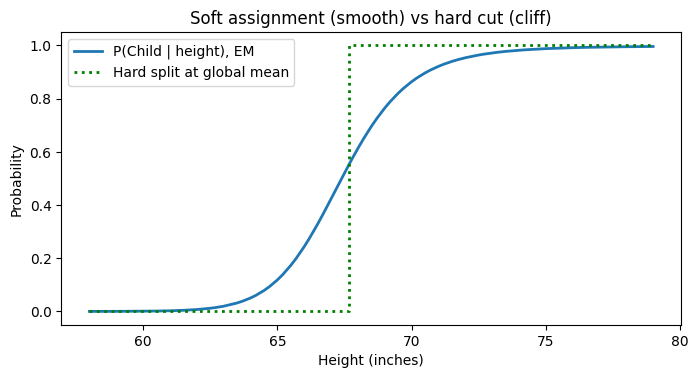
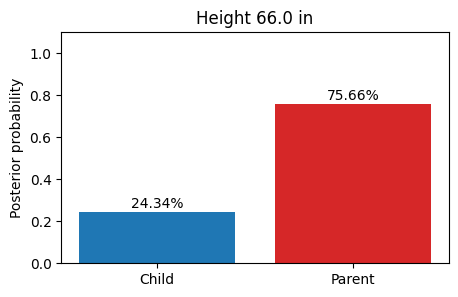
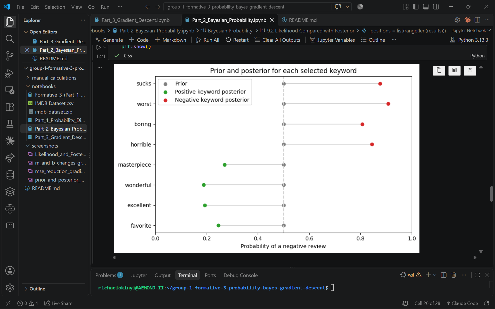
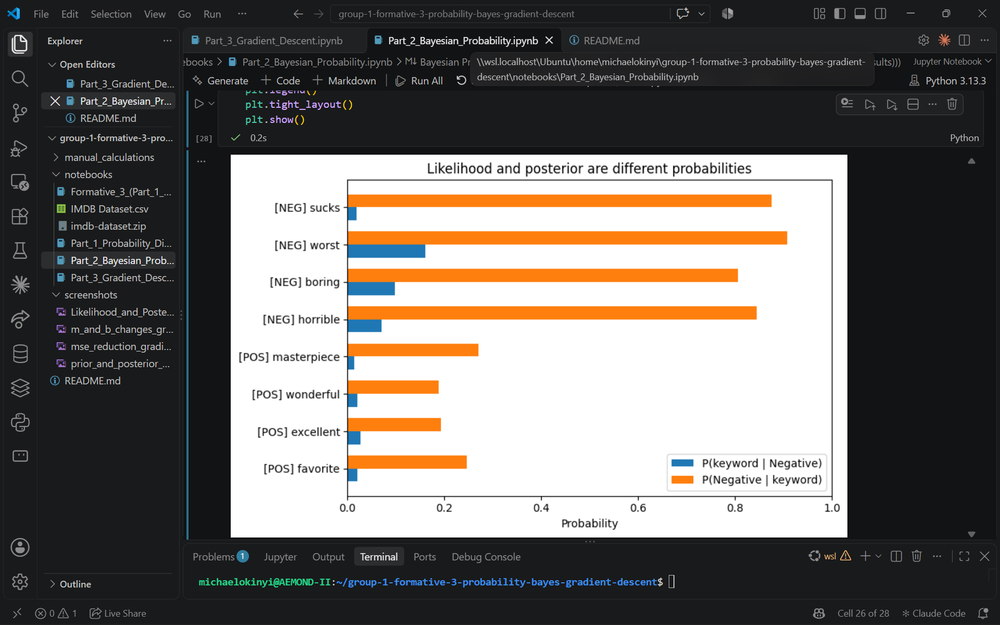

## Formative 3 - Probability Distributions, Bayesian Probability, and Gradient Descent Implementation

  

## Part 1: Probability Distributions

## [View the EM Code in Jupyter Notebook](https://colab.research.google.com/drive/1AvymL2H9MUXd1iaLN17oh25Skc9zfwBD?usp=sharing)

## Overview
Used the Expectation-Maximization (EM) algorithm to separate one unlabeled pile of heights into two hidden Gaussian groups: **mothers** and **sons** from the Galton Families dataset. The algorithm is written from scratch with NumPy, with no `sklearn`. The group labels are never passed to the model. They are only used at the end to score the result.

We compared mothers with sons only. Heights of all children together are bimodal (sons and daughters), which breaks the assumption that each group is a single bell curve.

## Implementation
- Loaded the dataset and kept **one row per family** for the mother. The file has one row per child, so a mother would otherwise be counted once for every child and the parent group would get too much weight.
- Pooled the 205 mothers and 481 sons into a single array of 686 heights.
- **Initialization:** means at the 25th and 75th percentiles of the pooled data, both variances set to the pooled variance, and π₁ = π₂ = 0.5.
- **E-step:** computed the responsibility of each component for every height with Bayes' theorem, `r_ik = π_k · N(x_i | μ_k, σ_k²) / Σ_j π_j · N(x_i | μ_j, σ_j²)`.
- **M-step:** updated the means, variances and mixing weights using the responsibilities as weights, where `N_k = Σ_i r_ik`: `μ_k = Σ r_ik · x_i / N_k`, `σ_k² = Σ r_ik · (x_i − μ_k)² / N_k`, `π_k = N_k / N`.
- **Stopping rule:** computed the log-likelihood after every update and stopped when it changed by less than 1e-6. EM never lowers it.
- Kept the code modular (DRY). One function, `weighted_components`, computes `π_k · N(x | μ_k, σ_k²)` and is reused by the log-likelihood, the E-step and the classifier.

## Tracking Table
| Iteration | μ1 (Children) | μ2 (Parent) | σ1² | σ2² | π1 | π2 | Log-Likelihood |
| :--- | ---: | ---: | ---: | ---: | ---: | ---: | ---: |
| 0 (Initialization) | 70.2000 | 65.0000 | 12.1720 | 12.1720 | 0.5000 | 0.5000 | -1861.4779 |
| 1 | 69.5172 | 65.7391 | 7.6412 | 9.6136 | 0.5112 | 0.4888 | -1825.3628 |
| 2 | 69.5443 | 65.6961 | 7.1496 | 9.8663 | 0.5131 | 0.4869 | -1824.6039 |

The log-likelihood jumps by about 36 in the first step and by less than 1 in the second. This is the expected pattern, a big early improvement and then a flattening curve. EM converged after 414 iterations at μ = [69.96, 65.14], σ² = [5.40, 7.49] and π = [0.53, 0.47].

## Live Classification
For any test height, the model returns exact posterior probabilities using the learned parameters. For a height of 66.0 inches:

| Group | Posterior |
| :--- | ---: |
| P(Child \| 66.0) | 0.2434 (24.34%) |
| P(Parent \| 66.0) | 0.7566 (75.66%) |

The two probabilities always add up to 1. Short heights are almost certainly one group and tall heights the other, while heights near the overlap, such as 67 inches (P(Child) = 0.42), are split between the two.

## Should we just split at the global mean?
No. The global mean of our data is 67.67 inches. A hard cut there fails for three reasons:

1. **It ignores overlap.** Mothers and sons overlap between roughly 64 and 70 inches. A hard cut labels a 67 inch person next to the line with the same certainty as a 55 or 78 inch person.
2. **Each pile is a sliced bell curve.** The lower pile loses its upper tail and the upper pile loses its lower tail, so averaging a pile gives a biased mean. EM uses every point with a probability weight, so nothing is cut off.
3. **It gives no uncertainty and learns nothing else.** A cut only says left or right. EM also learns the variances and mixing weights and returns a soft assignment for every point.

We measured this on our data instead of only claiming it. Used as a yes or no classifier, the mean split scored 0.805 and EM scored 0.813, so the accuracy is about the same. EM's advantage is not accuracy. It reports how sure it is, and 248 of 686 points (36%) have an EM confidence below 80%, while the mean split labels all of them with full certainty. Neither method recovers the true group means exactly, because the two groups overlap heavily.

## Visualizations
| Visualization 1 | Visualization 2 |
| :---: | :---: |
|  |  |
| The unlabeled pile the model sees | The two learned Gaussians and their mixture |

| Visualization 3 | Visualization 4 |
| :---: | :---: |
|  |  |
| Log-likelihood per iteration | Soft assignment (smooth) vs hard cut (cliff) |

| Visualization 5 |
| :---: |
|  |
| Posterior probabilities for a test height of 66.0 inches |

## Limitations
EM can only recover the groups as well as the two bell curves allow. Mothers and sons overlap heavily, so some heights are uncertain no matter how well the model fits. Using one gender of children is a modelling choice made to keep each group unimodal.

  

## Part 2: Bayesian Probability

## [View the Bayesian Probability Code in Jupyter Notebook](https://colab.research.google.com/drive/1gjpdRFj4dctJNPjS5bIJ8nawfWVyo_-F)

## Overview
Used Bayes’ Theorem to estimate the probability that an IMDB review is negative, given that it contains one of eight selected keywords: **favorite**, **excellent**, **wonderful**, **masterpiece**, **horrible**, **boring**, **worst**, or **sucks**. The analysis uses 50,000 labeled reviews and calculates the prior, likelihood, marginal probability, and posterior for each keyword.

## Implementation
- Loaded the IMDB review dataset and prepared each review for exact keyword matching.
- Stored each review’s words as a set, so a keyword is counted at most once per review.
- Calculated the prior as the proportion of all reviews labeled negative: `P(Negative) = 25,000 / 50,000 = 0.5`.
- For each keyword, calculated the likelihood `P(keyword | Negative)` and marginal `P(keyword)`.
- Applied Bayes’ Theorem: `P(Negative | keyword) = P(keyword | Negative) × P(Negative) / P(keyword)`.
- Compared each posterior with a direct count, `negative reviews containing keyword / all reviews containing keyword`, to check the result.
- Visualized the prior-to-posterior change and compared likelihood with posterior. The calculations use basic Python; Matplotlib is used for the charts.

## Results
Bayesian probability results for selected keywords:
| keyword | prior | likelihood | marginal | posterior | direct check |
|---------|-------|------------|----------|-----------|--------------|
| favorite | 0.5000 | 0.0208 | 0.0424 | 0.2455 | 0.2455 |
| excellent | 0.5000 | 0.0274 | 0.0710 | 0.1927 | 0.1927 |
| wonderful | 0.5000 | 0.0209 | 0.0555 | 0.1880 | 0.1880 |
| masterpiece | 0.5000 | 0.0130 | 0.0240 | 0.2700 | 0.2700 |
| horrible | 0.5000 | 0.0708 | 0.0419 | 0.8449 | 0.8449 |
| boring | 0.5000 | 0.0983 | 0.0610 | 0.8064 | 0.8064 |
| worst | 0.5000 | 0.1608 | 0.0886 | 0.9076 | 0.9076 |
| sucks | 0.5000 | 0.0190 | 0.0108 | 0.8764 | 0.8764 |

The direct-count check matched the Bayes posterior for each keyword. For example, `P(worst | Negative)` is 0.1608, while `P(Negative | worst)` is 0.9076. These are different conditional probabilities: the first asks how often “worst” appears in negative reviews; the second asks how often a review is negative when it contains “worst.” The prior and marginal connect these quantities in Bayes’ Theorem.

## Visualizations
The prior-to-posterior chart shows how each keyword shifts the baseline probability of a negative review (0.5).

The likelihood-versus-posterior chart highlights that `P(keyword | Negative)` and `P(Negative | keyword)` answer different questions and can have substantially different values.

| Visualization 1 | Visualization 2 |
| :---: | :---: |
|  |  |

## Keyword Rationale
We selected **favorite**, **excellent**, **wonderful**, **masterpiece**, **horrible**, **boring**, **worst**, and **sucks** because they express judgment in different ways: a strong evaluation, a reaction to the experience, a comparison, and an informal criticism. 

This gives us a range of signals rather than four near-synonyms. Because matching is exact, related forms such as “sucked” are not counted.

## Limitations
These results describe associations in this dataset, not proof that a keyword causes negative sentiment.

Negation, sarcasm, and context can affect how a word is used, and exact matching does not include related word forms.

  

## Part 3 : Gradient Descent 

## [View the Gradient Descent Code in Jupyter Notebook](https://colab.research.google.com/drive/1I9rasJMWwKXod7UBxlvfI1thS5Rpq972?usp=sharing)

## Overview
Implemented linear regression with two input features and applied gradient
descent to optimize the model's weights and bias.

## Implementation
- Calculated predictions and Mean Squared Error (MSE)
- Computed gradients using the chain rule
- Updated the model parameters over three iterations
- Used SciPy to approximate derivates and Matplotlib to visualize the results

## Results 
We implemented gradient descent to optimize the weights (\(m_1, m_2\)) and a single shared bias (\(b\)) of a linear regression model over three iterations. The MSE decreased at every update, from 61.00 to 6.85, 2.72, and finally 2.39, showing that the model's predictions improved. The final weights were approximately \(m = [-1.37, 1.10]\) and \(b = 0.94\), producing predictions of \([2.85, 6.41]\) against actual values of \([5, 6]\). The manually calculated gradients matched SciPy's numerical derivatives at each iteration.

## Visualizations
| Visualization 1 | Visualization 2 |
| :---: | :---: |
|  |  |
